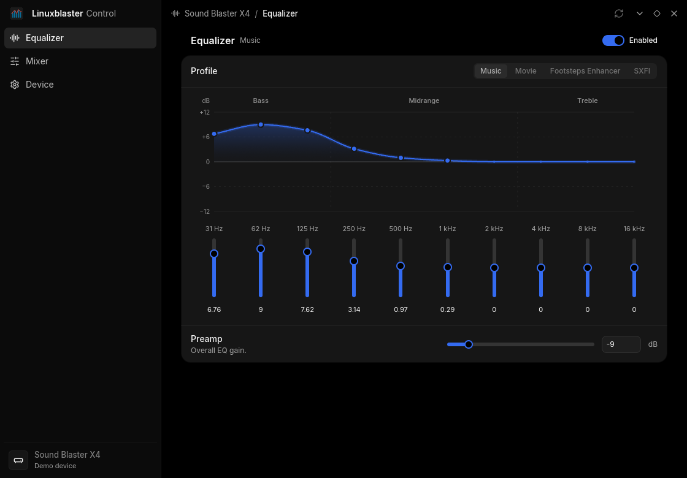

# Linuxblaster Control — Sound Blaster X4

A native Linux controller for the **Creative Sound Blaster X4 (`041e:3278`)**.
Forked from [RizeCrime/linuxblaster_control](https://github.com/RizeCrime/linuxblaster_control),
which targets the G6. This branch targets the X4 only.



Audio keeps working through Linux's standard `snd-usb-audio` driver. The app
changes device settings over the X4's serial control port (`/dev/ttyACM*`). No
kernel driver, vendor software or background service is needed.

## Features

- Speakers/headphones output, Direct Mode and high headphone gain
- Super X-Fi Off / On / Battle Mode
- The four onboard EQ slots (Music, Movie, Footsteps Enhancer, SXFI) with names
  read from the device
- Hardware EQ: enable, preamp and ten bands, saved to the active slot
- Playback, monitoring and recording levels, mutes and Microphone Boost
- JSON output of the full state (`--status`) or all stored EQ curves (`--profiles`)

All controls edit local drafts. Output, profiles, Super X-Fi, Direct Mode, gain,
EQ, mixer levels, mutes and boost reach the device only after **Apply**.
**Revert** discards pending edits, and background reads preserve them. The Apply
bar appears on any page only while edits are pending or being applied, and
applies all pending settings together.

Output, mode and profile choices can load a different EQ curve. Apply those
selections before editing their EQ; selecting a new context discards old EQ
drafts with a notice. The entire batch is validated before its first write,
stops on the first failure, and each change is read back before continuing. If a write
fails, the app reconnects and shows the actual state; it never retries a write
automatically. SXFI personalization, SmartComms, Scout Mode and DAC filters are
not supported.

## Install on NixOS

```nix
# flake inputs
inputs.linuxblaster_control.url = "github:synsejse/linuxblaster_control";

# NixOS modules
linuxblaster_control.nixosModules.default
{ hardware.soundblaster-x4.enable = true; }
```

The module installs the app (also available as `linuxblaster`) and a udev rule.
The rule gives the active desktop session access to the X4 and tells
ModemManager to ignore it.

The repository has no submodules, so a plain `github:` input is enough. Nix
packages that build from its `Cargo.lock` outside this flake must declare the
`iced_t3` and `soundblaster-x4` Git dependencies:

```nix
cargoLock = {
  lockFile = "${src}/Cargo.lock";
  outputHashes = import "${src}/packaging/cargo-git-hashes.nix";
};
```

The font licenses to install are in `packaging/licenses/`.

## Run

```sh
linuxblaster_control                 # GUI
linuxblaster_control --status        # print device state as JSON
linuxblaster_control --profiles      # print stored EQ curves as JSON
linuxblaster_control --demo          # offline preview, no device access
linuxblaster_control --port /dev/serial/by-id/usb-Creative_Technology_Ltd_Sound_Blaster_X4_<serial>-if01
```

Only one program can control the X4 at a time, so close the GUI before running
a query. `--port` is needed only when several X4s are connected.

## Development

```sh
git clone https://github.com/synsejse/linuxblaster_control
nix-shell                     # or: nix develop
cargo run --locked -- --demo
cargo test --locked --all-targets
cargo clippy --locked --all-targets -- -D warnings
nix build                     # package
```

Without Nix, you need a Rust toolchain, `pkg-config`, libudev headers and the
usual Wayland/X11 graphics libraries.

The app is a single Rust package: `src/main.rs` handles the CLI and
`src/lib.rs` starts the GUI, with focused modules beside it. Offline fixtures
live in `fixtures/`; see [desktop usage and testing](docs/usage.md).
Its reusable libraries live in separate repositories:

- [`soundblaster-x4`](https://github.com/synsejse/soundblaster-x4-rs): the X4
  device API, captured-traffic tests and
  [protocol reference](https://github.com/synsejse/soundblaster-x4-rs/blob/main/docs/PROTOCOL.md).
- [`iced_t3`](https://github.com/synsejse/iced_t3): shared Iced design components
  and client-side window decorations.

Both are Cargo Git dependencies pinned by full commit and exact package version
in `Cargo.toml`. Cargo commands check the app; run each
library's tests in its own repository.

To move a pin, change `rev`, run `cargo update -p <package>`, and set the new
source hash in `packaging/cargo-git-hashes.nix`, for example:

```sh
nix flake prefetch --json github:synsejse/soundblaster-x4-rs/<rev>
nix flake prefetch --json github:synsejse/iced_t3/<rev>
```

Also refresh `packaging/licenses/` if the bundled fonts' licenses changed.

Tests never touch hardware. The API repository's `examples/hardware_check.rs`
is an opt-in live test that backs up the device settings and restores them
afterwards.

## License

MIT, as upstream. See [LICENSE](LICENSE).

See [shared code conventions](docs/conventions.md) for organization and formatting.
