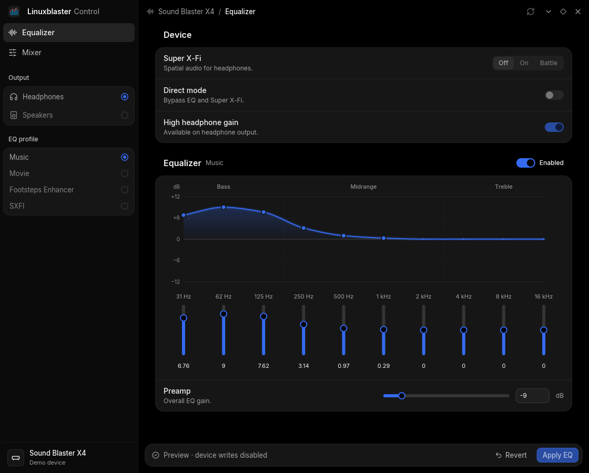

# Linuxblaster Control — Sound Blaster X4

A native Linux controller for the **Creative Sound Blaster X4 (`041e:3278`)**.
Forked from [RizeCrime/linuxblaster_control](https://github.com/RizeCrime/linuxblaster_control),
which targets the G6. This branch targets the X4 only.



Audio keeps working through Linux's standard `snd-usb-audio` driver. The app
changes device settings over the X4's serial control port (`/dev/ttyACM*`). No
kernel driver, vendor software or background service is needed.

## Features

- Speakers/headphones output, Direct Mode and high headphone gain
- Super X-Fi Off / On / Battle Mode
- The four onboard EQ slots (Music, Movie, Footsteps Enhancer, SXFI) with names
  read from the device
- Hardware EQ: enable, preamp and ten bands, saved to the active slot
- Playback, monitoring and recording levels, mutes and Microphone Boost
- JSON output of the full state (`--status`) or all stored EQ curves (`--profiles`)

Every change is read back from the device before the UI shows it. If a write
fails, the app reconnects and shows the actual state; it never retries a write
automatically. SXFI personalization, SmartComms, Scout Mode and DAC filters are
not supported.

## Install on NixOS

```nix
# flake inputs
inputs.linuxblaster_control.url = "git+https://github.com/synsejse/linuxblaster_control?ref=x4-support&submodules=1";

# NixOS modules
linuxblaster_control.nixosModules.default
{ hardware.soundblaster-x4.enable = true; }
```

The module installs the app (also available as `linuxblaster`) and a udev rule.
The rule gives the active desktop session access to the X4 and tells
ModemManager to ignore it.

## Run

```sh
linuxblaster_control                 # GUI
linuxblaster_control --status        # print device state as JSON
linuxblaster_control --profiles      # print stored EQ curves as JSON
linuxblaster_control --demo          # offline preview, no device access
linuxblaster_control --port /dev/serial/by-id/usb-Creative_Technology_Ltd_Sound_Blaster_X4_<serial>-if01
```

Only one program can control the X4 at a time, so close the GUI before running
a query. `--port` is needed only when several X4s are connected.

## Development

```sh
git clone --recurse-submodules -b x4-support https://github.com/synsejse/linuxblaster_control
nix-shell                     # or: nix develop
cargo run --locked -- --demo
cargo test --locked --workspace --all-targets
cargo clippy --locked --workspace --all-targets -- -D warnings
nix build                     # package
```

Without Nix, you need a Rust toolchain, `pkg-config`, libudev headers and the
usual Wayland/X11 graphics libraries.

The workspace has three crates:

- [`crates/app`](crates/app/README.md): `linuxblaster_control`, the Iced GUI and CLI.
- [`crates/iced_t3`](https://github.com/synsejse/iced_t3): `iced_t3`, a reusable
  library with T3 Code's design and client-side window decorations for any Iced
  app. It lives in its own repository and is included as a git submodule.
- [`crates/x4`](crates/x4/README.md): `soundblaster-x4`, a standalone Rust API for
  the X4 control protocol. Its [protocol reference](crates/x4/docs/PROTOCOL.md)
  documents the wire format and device quirks.

Tests never touch hardware. `crates/x4/examples/hardware_check.rs` is an opt-in
live test that backs up the device settings and restores them afterwards.

## License

MIT, as upstream. See [LICENSE](LICENSE).
