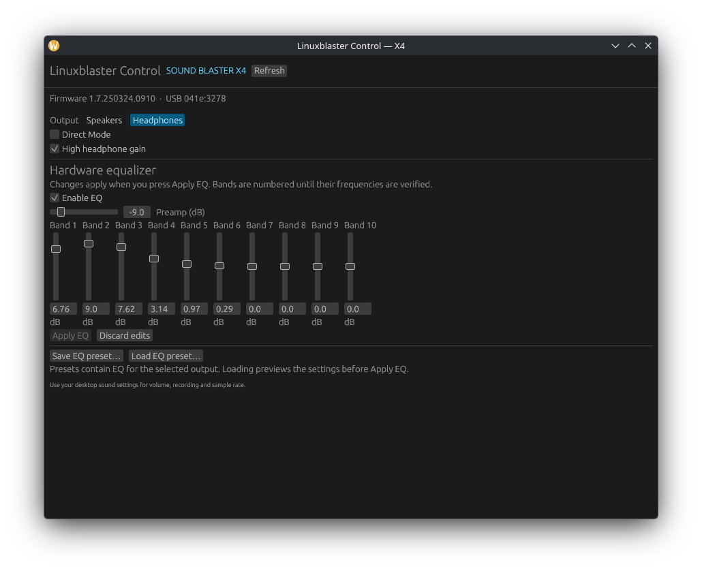

# Linuxblaster Control — Sound Blaster X4

A Rust/egui controller for the **Creative Sound Blaster X4 / SB1815 (`041e:3278`)**,
forked from [RizeCrime/linuxblaster_control](https://github.com/RizeCrime/linuxblaster_control).
The upstream MIT license and Git history are preserved. This branch targets the X4,
not the G6. The X4 backend is a Rust implementation of the accompanying X4 protocol research.

Audio uses Linux's `snd-usb-audio`; proprietary settings use `cdc_acm` through
`/dev/ttyACM*`. The app never detaches the audio driver or resets the USB device.
It does not require vendor DLLs, a new kernel driver, Python, or a D-Bus daemon.
One background worker owns the serial connection, serializes commands and refreshes
state every three seconds. Disconnects trigger reconnect attempts; failed writes
are never replayed. Closing the window closes the app.

## Available controls

- Read firmware, capabilities, output, Direct Mode, headphone gain and hardware EQ.
- Switch speakers/headphones; toggle Direct Mode and headphone gain.
- Enable/disable EQ and edit preamp plus ten hardware EQ bands.
- Save/load local EQ presets, tagged for X4 and speaker/headphone output.
  Loading previews the preset; **Apply EQ** performs the changes.
- Read stored speaker/headphone device profiles as JSON (`--profiles`).

Every setter requires a successful acknowledgement and matching readback. EQ
application is a sequence of individual changes, not an atomic transaction: a failure
can leave a partially applied EQ. The app reports this and reconnects to read actual state.
It never restores presets automatically on reconnect.

**Experimental:** recorded research proves the unlock, reads and EQ preamp changes
on firmware `1.7.250324.0910`. Routing/Direct Mode/gain setters are based on vendor
protocol analysis; the research did not exercise them on this unit. Live Linux status/profile reads and the native GUI have also passed. Linux cold plug,
suspend/resume, acoustic behavior and PCM formats still require hardware validation.
See [protocol details](docs/PROTOCOL.md) and [validation](docs/VALIDATION.md).

EQ band frequencies and device limits have not been established. Bands are numbered
1–10 in the GUI; the application's ±12 dB input bound is conservative, not a queried
hardware capability. Therefore the upstream G6 AutoEq frequency mapping is not used.
G6 SBX, lighting, microphone DSP, mixer setters, Scout Mode and DAC filters are not
exposed. SXFI/personalization, SmartComms and stored-profile writes are unresolved.
Use ALSA/PipeWire for ordinary volume, recording and sample-rate configuration.
The G6-specific HID backend, USB reset helpers, capture tools and cold-boot workarounds
were removed from this branch; they remain available in upstream Git history.

## Build and run

On Linux, install a current Rust toolchain, `pkg-config` and the libudev development
package (e.g. `libudev-dev` on Debian/Ubuntu). The desktop needs its usual Wayland/X11
and graphics libraries; the file dialog uses the desktop portal/D-Bus.

```sh
cargo build --locked --release
./target/release/linuxblaster_control
./target/release/linuxblaster_control --status
./target/release/linuxblaster_control --profiles
./target/release/linuxblaster_control --port /dev/serial/by-id/usb-Creative_Technology_Ltd_Sound_Blaster_X4_YOUR_SERIAL-if01
```

Automatic selection requires exactly one X4. `--port` accepts a stable by-id path,
and verifies its USB identity before opening it. Close the GUI before using a CLI
query or another controller. Queries may unlock the control channel but do not
change audio settings. G6 profile JSON and old G6 CLI flags are not compatible.

Install the narrowly scoped desktop access rule, then replug the device:

```sh
sudo install -m 0644 packaging/70-linuxblaster-control.rules /etc/udev/rules.d/
sudo udevadm control --reload-rules
```

The rule grants access to the active local desktop session and tells ModemManager
to ignore the X4. Headless users need their distribution's serial-device access
policy, commonly membership in `dialout`. Run the app as your ordinary user.

## NixOS

```sh
nix develop
cargo test --locked --all-targets
cargo run
# Build the packaged application, without installing or activating anything:
nix build
```

The flake exports `packages.<system>.blaster-x4-control` and a NixOS module:

```nix
# Flake input:
inputs.linuxblaster_control.url = "github:synsejse/linuxblaster_control/x4-support";

# In your NixOS modules list:
linuxblaster_control.nixosModules.default
{ hardware.soundblaster-x4.enable = true; }
```

The module installs the app and X4 udev rule. It does not change audio drivers.
The provided package builds on x86_64-linux and aarch64-linux; only the local
architecture is covered by the validation report. Release packaging for tar/deb/rpm/
AppImage is retained but needs separate distribution testing.

## Development

```sh
cargo fmt --check
cargo test --locked --all-targets
cargo clippy --locked --all-targets -- -D warnings
```

- `src/protocol.rs`: framing, unlock and serial transactions.
- `src/lib.rs`: X4 capabilities, settings, presets and profile decoding.
- `src/app.rs`: background device worker and native GUI.
- `src/tests.rs`, `tests/fixtures`: deterministic tests using recorded X4 traffic.

No test accesses real hardware. Test fixtures contain selected, unchanged packet bytes from the research folder;
protocol provenance is recorded in `docs/RESEARCH.md`. Its evidence paths refer to
the original research bundle, which is not fully duplicated in this fork.


